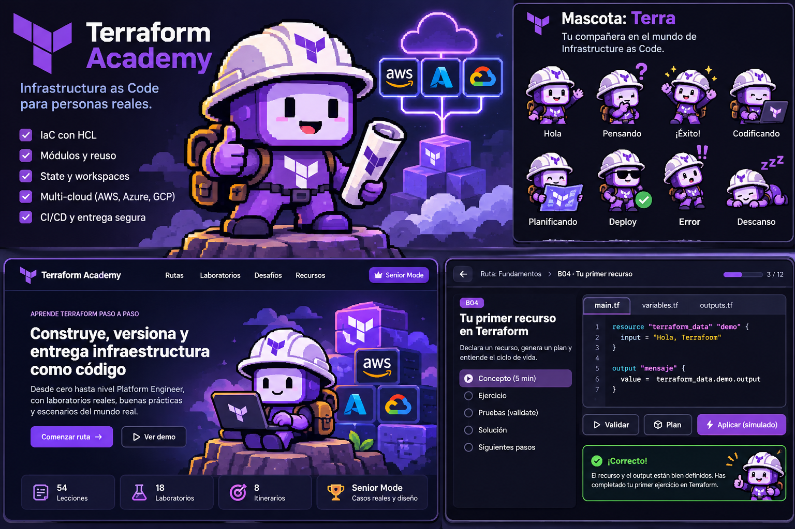

# TerraPixel Academy v1.7 — Senior Mode y documentación integral de requisitos

## Documento principal obligatorio

Lee **[`TODO_LO_QUE_DEBE_TENER_ESTA_APP.md`](TODO_LO_QUE_DEBE_TENER_ESTA_APP.md)** antes de desarrollar, auditar o declarar completa esta aplicación. Contiene 36 lecciones explicadas una a una, los 18 escenarios Senior con rúbricas, S18 con ocho hitos, rutas, diseño aprobado, especificación técnica, casos negativos, pruebas, faltantes y el anexo maestro íntegro. Es un **contrato de requisitos**, no una afirmación de que todos estén implementados o validados.

**Mejoras que se incorporan en esta rama:** vistas `src/uiSeniorCase.ts`, `src/uiCatalog.ts` y `src/uiCliEvidence.ts` con componentes Preact; se mantienen legacy views en `src/main.ts` para compatibilidad y no eliminar funciones, por lo que la migración total Preact sigue abierta. La CLI Terraform, CodeMirror 6, Vite/lockfile y E2E HTTP real siguen sin evidencia de aprobación.

**Inicio rápido:** Node.js 20.19+; descomprime, `npm start`, abre `http://localhost:4173`. No necesitas instalar dependencias para iniciar ni compilar el build estático con `npm run build`.

## Novedades verificables de v1.6

- Senior Dashboard, navegación, cabecera y footer ahora son componentes **Preact declarativos reales**. Las páginas internas de lecciones y casos conservan plantillas HTML por compatibilidad: la migración a Preact completo sigue INCOMPLETA.
- Senior Plan Release Gate: carga local de `terraform show -json`, revisión determinista de operaciones destructivas, drift, acciones desconocidas, owners, costos y rollback. Emite solo `BLOCKED`, `NEEDS_EVIDENCE` o `READY_FOR_HUMAN_REVIEW`. **Jamás autoriza terraform apply**. Exporta informe `.md` sin datos before/after ni variables.
- TypeScript 5.8.3 MIT está incluido en `tools/typescript/` para `npm run build` / `npm run typecheck` sin instalación npm. No se falsifica un `package-lock.json`.
- 54 ZIP internos de laboratorios y Senior preservados; el repositorio previo mantiene todos sus archivos y scripts.
- Nuevas pruebas Node y Chromium embebidas de políticas, revocación de resultados previos y componentes Preact.

**Límites NO VERIFICADOS / SIN RESOLVER:** CodeMirror 6 (se conserva CodeMirror 5), migración total de vistas a componentes Preact, build de Vite y lockfile, ejecución real de 37 tests Terraform CLI, E2E HTTP de Chromium, CI GitHub externa y auditoría legal de marca. El editor del navegador NO ejecuta HCL real. `docs/AUDITORIA_FINAL_V1_6.md` contiene el estado de release sin aprobación ficticia.

---

## Histórico: documentación v1.5.1 conservada para trazabilidad

# TerraPixel Academy — aprender Terraform con experiencia pixel art

**Aplicación web educativa para enseñar HashiCorp Terraform, desde fundamentos hasta Platform Engineering.**  
**Estado de esta entrega:** versión 1.5.1 educativa PARCIAL, aún NO APROBADA frente a la especificación completa (véase `docs/AUDITORIA_FINAL_V1_5.md` y `docs/RELEASE_NOTE_V1_5_1.md`). Frontend funcional en TypeScript con arte generado para la academia, 36 lecciones, 5 minijuegos, 18 retos Senior, visor de grafos/planes y packs de laboratorios locales. Los resultados de ejecución Terraform CLI y cloud están `NOT_RUN` en el entorno de generación.

La marca «TerraPixel Academy» es **provisional** y no pretende afiliación con HashiCorp, Terraform, proveedores cloud ni Kubernetes. Antes de publicación comercial se debe hacer revisión de marca, derechos de iconos y textos.



## Entrega actual v1.5.1 — Senior Mode + DevSecOps + inspector de planes

Esta versión conserva el catálogo de 36 lecciones, 18 escenarios Senior con what-if/ADR, el capstone S18 de ocho hitos, los ZIP de laboratorios y todos los assets originales. También incorpora:

- **Preact ESM real como renderer del shell** con vistas internas todavía basadas en plantillas HTML; no es una migración declarativa total a componentes.
- **CodeMirror 5.58.3 real offline** para editar HCL, con coloreado de sintaxis, indentación, números de línea y un `textarea` de respaldo; la versión obligatoria CodeMirror 6 aún no está implementada.
- **Análisis de `terraform show -json`** importado por el alumno, operaciones peligrosas, `resource_drift` si existe, informe Markdown sin valores before/after y ejemplo sintético descargable. Las direcciones de recursos pueden contener información privada.
- **Senior Mode reforzado** con rúbricas, revisión de decisiones, exportación de portafolio y revocación automática del progreso cuando se invalida la evidencia.
- **DevSecOps local** (`npm run security:local`), configuración Biome, Dependabot, workflow de CI y playbook de revisión de cambios IaC. La CLI Biome y npm audit online no se han ejecutado en este entorno.
- **Runner Terraform que trabaja sobre copias temporales**, para evitar que `fmt/init/test` escriban en el árbol de ejercicios originales. La CLI real sigue sin estar disponible para ejecutarlo aquí.
- **Build estático y arranque local reproducidos**, con controles de integridad ZIP y SHA-256. El build estándar no es el bundle Vite.

**No dar por completados:** frontend enteramente en componentes Preact, CodeMirror 6, lockfile de npm, build Vite probado, 37 tests con Terraform CLI, E2E real por HTTP ni revisión jurídica de la marca. Estos asuntos están documentados en la auditoría v1.5.

## Versión 1.3 — historial de cambios


Este release **preserva todas las rutas del ZIP v1.2**; no se eliminaron archivos de la entrega anterior. Se corrigió la posibilidad de conservar una autoevaluación completada después de alterar su decisión, checklist o ADR. Ahora el progreso se reconcilia al cargar, editar e importar respaldos; el contador de XP deja de contabilizar un caso cuyo gate ya no se cumple.

**Nuevos componentes de aprendizaje Senior:**

- **18 ejercicios «what-if» interactivos**, uno por caso (S01–S18), con decisión segura/insegura, resultado y evidencia exigida. Todos son sintéticos; no son salidas Terraform CLI.
- **Portafolio Senior descargable** (`TerraPixel-Portfolio-Senior.md`): integra los 18 ADR y deja explícitamente `NOT_RUN` en ejecución CLI, cloud y revisión externa.
- **S18 con evidencia propia por hito:** ahora cada una de sus ocho etapas dispone de textarea y estado PASS/FAIL/NOT_RUN/BLOCKED; las notas deben ser distintas, tener contenido mínimo y su casilla solo se habilita tras escribirla. Es una autodeclaración estructural, no una validación experta.
- **18 bundles Senior enriquecidos:** cada pack contiene `WHAT-IF-SCENARIO.json`, `WHAT-IF-WORKSHEET.md` y `CASE-REVIEW-SHEET.md`, además de los archivos previos. Incluye en S18 `capstone/` con módulo Terraform local real, `terraform_data`, tests `.tftest.hcl` en modo plan y ocho hojas de evidencia.
- **Runner local Terraform CLI:** `bash scripts/verify-terraform-labs.sh` o `scripts/verify-terraform-labs.ps1`. Ejecuta 36 labs y capstone S18 (37 checks) y registra archivos de salida locales; sin Terraform CLI responde `NOT_RUN` (código 3). El workflow `terraform-labs.yml` lo ejecuta en CI cuando GitHub Actions dispone de Terraform.

**Comprobaciones realizadas:** TypeScript estricto, tests Node, build estático, pruebas Chromium embebidas, comparación recursiva de los ZIP Senior y HTTP Node. Consulta `docs/SENIOR_MODE_AUDIT_V1_3.md` para resultados, límites y gates de release.

**Pendientes históricos de v1.3 (algunos parcialmente atendidos en v1.5.1):** frontend totalmente Preact, editor CodeMirror 6, dependencias npm con lockfile/Vite verificado, CLI Terraform y navegador E2E HTTP. No se los declara implementados.

## Versión 1.2 — cierre reforzado de Senior Mode

Se conserva **todo el contenido de v1.1** y se añadieron las siguientes implementaciones (sin sustituir las funciones anteriores):

- **18 rúbricas de incidente específicas** en `src/senior.ts`, `labs/senior/S01…S18/incident.json` y `REVIEW-GATES.md` (4 controles propios por escenario).
- **18 ZIP Senior regenerados**, cada uno con toda la carpeta anterior más `REVIEW-GATES.md`; se contrastan byte por byte con fuentes.
- **Exportar ADR/informe por caso:** botón en el gate y la fase Evidencia. El Markdown contiene tu decisión, los cuatro controles, tu ADR escrito y estados externos `NOT_RUN` sin afirmar pruebas ficticias.
- **Senior Gate estructural reforzado:** requiere secciones de diagnóstico, decisión, riesgos, evidencia y rollback con contenido; la evidencia indica `PASS`, `FAIL`, `BLOCKED` o `NOT_RUN`. Sigue siendo autoevaluación, no revisión semántica.
- **Simuladores corregidos:** CIDR S09, integridad de commits S11 y réplicas/costos S14 ahora usan realmente los valores escritos por el alumno.
- **Pruebas adicionales:** suite Node, servidor HTTP real y pruebas de interacción Chromium con módulos embebidos (limitaciones documentadas en `docs/SENIOR_MODE_AUDIT_V1_2.md`).

### Verificación rápida

```bash
npm start              # versión ya compilada, no requiere npm install
npm run qa             # typecheck y tests Node (requiere TypeScript instalado/global)
npm run build          # reconstruir y preparar dist/ (requiere TypeScript)
python3 scripts/release-audit.py # integridad de contenido/ZIPs internos
```

La prueba opcional `python3 tests/browser-embedded.py` requiere Playwright Python y Chromium preinstalados. Su modalidad embebida prueba interacciones sin visitar localhost; **no sustituye E2E HTTP, persistencia ni carga de imágenes**.

### Pendientes obligatorios antes de aprobación

En v1.2 no estaban resueltos **Preact ni CodeMirror**; en v1.5.1 ya existen el montaje Preact y CodeMirror 5, pero faltan CodeMirror 6, migración completa a componentes, el **lockfile npm**, la **ejecución de Terraform CLI para 36 labs** ni un **E2E HTTP Chromium completo**. El equipo no debe interpretar que `dist/` constituye build Vite ni que las 18 autoevaluaciones equivalen a revisión técnica real.

## Cómo arrancar de inmediato (SIN instalar dependencias)

1. Descomprime el ZIP.
2. Instala o usa Node.js 20.19+.
3. Abre una terminal en la carpeta `TerraPixel-Academy` (o usa `INICIAR-WINDOWS.cmd` / `INICIAR-LINUX-MAC.sh`).
4. Ejecuta:

```bash
npm start
```

5. Abre **http://localhost:4173** en tu navegador.

`npm start` usa un servidor Node incluido en `scripts/server.mjs` (sin instalar nada con npm). **No abras `index.html` directamente por `file://`**: utiliza módulos ES de JavaScript y necesita un servidor HTTP local.

También puedes ejecutar `python3 -m http.server 4173` si tienes Python y prefieres ese método.

## Qué incluye (operativo en navegador)

| Área | Contenido |
|---|---|
| Inicio | Hero pixel art, mascota Terra, rutas, progreso y CTA |
| Aprender | 12 Básico + 12 Intermedio + 12 Avanzado = **36 lecciones** |
| Ejercicios | Editor HCL de texto con 36 reglas específicas y tests de muestras |
| Preguntas | Quiz por lección con respuesta correcta y retroalimentación |
| Minijuegos | **5 juegos** y **21 preguntas** con explicaciones |
| Senior Mode | **18 casos** con misión, decisión, review, checklist, ADR y operaciones |
| Simuladores Senior | CIDR, costo estimado, plan integrity, locking, drift y for_each |
| Plan Explorer | Cuatro planes **sintéticos** y evaluación de riesgo de cambios |
| Grafo | Tres visualizadores y selección de nodos, dependencias y riesgo |
| Laboratorios | **36 packs ZIP** locales con `.tf`, `.tftest.hcl`, README y referencia. **Advertencia:** 36 configuraciones HCL diferenciadas, con 36 pruebas `.tftest.hcl` específicas. Pendiente ejecutar la CLI para comprobar su validez real. |
| Senior assets | **18 ZIP** con incidentes sintéticos, diff, ADR, runbook y checklist |
| Capstone S18 | Ocho hitos, módulos `terraform_data` offline y entornos demostrativos |
| Progreso | XP, insignias, favoritos en datos, autosave de código y ADR, backup JSON |
| Ajustes | Oscuro/claro, reducido movimiento, tamaño de texto, importar y borrar datos |
| Otros | 12 sprites Terra PNG, glosario, recursos, responsive, navegación por teclado |

### Importante: límites de la implementación

- El botón **Evaluar reglas** usa patrones didácticos sobre texto y una verificación básica de delimitadores. **No es el compilador HCL**, no sustituye `terraform fmt`, `terraform validate`, `terraform plan`, ni comprueba infraestructura remota.
- **No existe un `terraform apply` remoto desde el navegador**. Por seguridad tampoco se solicitan credenciales cloud.
- Los planes, costos, grafos y los incidentes Senior son **fixtures sintéticos**; se etiquetan dentro de la app.
- Los tests de `practice.tftest.hcl` se incluyen para correrlos en el equipo del estudiante. **Ahora cada carpeta comprueba un resultado asociado al tema propio. Las 36 pruebas siguen NO EJECUTADAS con Terraform CLI.** **No fueron ejecutados con Terraform CLI en este entorno**; su estado inicial es `NOT_RUN`.
- La finalización de Senior Mode es **autoevaluación guiada**, no validación semántica de ADR, una certificación oficial ni un indicador de experiencia laboral.
- No hay login, backend, API remota, pagos, gestión de múltiples usuarios ni cloud sandbox: esas fases no se entregan. Los retos Senior exigen cinco apartados de ADR y 120 caracteres como comprobación estructural, no una evaluación experta del contenido.
- En v1.5.1 el editor HCL utiliza **CodeMirror 5 real vendorizado** con `textarea` como fallback. Mantiene evaluaciones didácticas, no un parser HCL completo ni CodeMirror 6.

## Tecnología y arquitectura

- **Frontend:** TypeScript estricto + Preact ESM en el montaje + vistas HTML con DOM delegado, ECMAScript modules, CodeMirror 5 HCL offline, CSS tokens y pixel art original.
- **Build estático comprobado:** `npm run build` utiliza TypeScript + copia de assets; no depende del bundling de Vite. **Vite opcional:** `npm run build:vite` requiere dependencias npm que este entorno no pudo resolver.
- **Ejecutable offline:** carpeta `app/` con JavaScript compilado de `src/`, sin dependencia npm para ejecutar `npm start`.
- **Estado local:** `localStorage` versionado, exportación/importación con sanitización de IDs y longitud.
- **Tests:** Node Test Runner (sin Jest ni Vitest) + chequeo de tipos, carpetas y ZIPs.
- **Assets:** sprites Terra PNG hechos específicamente para el proyecto; referencia visual aprobada guardada en `assets/reference`.

**Desviación vigente frente a la especificación V1.1:** se usa Preact como shell y CodeMirror 5 offline, pero faltan las vistas declarativas completas, CodeMirror 6 y el build Vite/lockfile verificado. `npm run build` compila TypeScript y copia assets, no construye con Vite. Este límite no se presenta como implementado.

## Desarrollo con npm y Vite (opcional; requiere Internet)

```bash
npm install
npm run dev        # Vite + recompilador TS en modo watch
npm run typecheck  # TypeScript estricto
npm test           # Test Runner de Node
npm run build      # Compila TS y genera dist/ estático (probado)
npm run build:vite # Alternativa Vite (requiere npm install; NO probada aquí)
```

Si no puedes usar Internet pero tienes una CLI global de TypeScript, reconstruye el JS con:

```bash
tsc -p tsconfig.json
npm test
npm start
```

### Carpetas principales

```text
TerraPixel-Academy/
├── index.html, styles.css, package.json, vite.config.js
├── src/
│   ├── main.ts             # UI, rutas e interacciones
│   ├── curriculum.ts       # 36 lecciones
│   ├── senior.ts           # 18 casos y ocho hitos capstone
│   ├── seniorSnippets.ts   # ejemplos de revisión de código
│   ├── simulators.ts       # CIDR, costo e integridad de fixture
│   ├── fixtures.ts         # planes/grafos sintéticos
│   ├── games.ts            # juegos y preguntas
│   └── engine.ts           # reglas, estado, import/export y XP
├── app/                   # ES modules compilados, listos para ejecutar
├── assets/
│   ├── terra/              # 12 poses + spritesheet PNG
│   ├── reference/          # PNG aprobado por el usuario
│   ├── labs/               # 36 ZIP descargables
│   └── senior/             # 18 ZIP de incidentes
├── labs/
│   ├── offline/            # 36 proyectos locales, seguros por defecto
│   └── senior/             # 18 casos con ADR/runbooks
├── docs/                  # spec auditada y reporte QA
├── tests/                 # tests unitarios/integridad
├── scripts/               # servidor, dev y utilidades
└── .github/workflows/     # web QA, labs CLI y despliegue manual
```

## Ejecutar laboratorios reales

Por ejemplo B04:

```bash
cd labs/offline/B04
terraform version
terraform fmt -check
terraform init -backend=false
terraform validate
terraform test
```

El `test` usa `command = apply` **solo con `terraform_data`**, un recurso incorporado sin provider cloud. Genera state efímero local de tests; no se ejecutan proveedores AWS/Azure/GCP. Los ejemplos `.tf.txt` son referencias y deliberadamente no forman parte de los archivos `.tf` ejecutados.

**Para laboratorios con AWS real** (no implementados como ejecución remota), habilita únicamente sandboxes con cuenta dedicada, cuota, presupuesto, revisión de planes, bloqueo de state y limpieza programada.

## Auditoría posterior

La auditoría Zero Omissions detectó desviaciones P1 en stack y cobertura semántica de laboratorios. El paquete no debe anunciarse como completo. Consulta `docs/AUDITORIA_TOTAL_ZERO_OMISSIONS.md` y `docs/QA_REPORT.md`.

## Verificaciones y estado de evidencia

Consulta [`docs/QA_REPORT.md`](docs/QA_REPORT.md) para la evidencia ejecutada de TypeScript/Node y los bloqueos de browser/CLI de esta sesión. Los workflows están preparados, **no se afirma que GitHub Actions haya corrido o aprobado**.

## Fuentes de diseño

- Imagen aprobada del usuario: `assets/reference/concepto-aprobado.png`.
- Inspira su composición en GoPixel Academy: navegación, rutas, aula, juegos, senior, progreso y tema.
- Se ha creado una **mascota propia** (Terra) en 12 poses para no reutilizar la mascota Gopher del proyecto Go.
- Especificación técnica: `docs/TERRAFORM_ACADEMY_MASTER_SPEC_V1_1_AUDITADA.md`.

## Privacidad y marca

- La aplicación no incluye analítica, trackers ni APIs en producción. Los enlaces de recursos externos se abren solo cuando el usuario los pulsa.
- El backup local contiene código, texto de ADR, decisiones y progreso. Revísalo antes de compartirlo.
- TerraPixel es un **proyecto independiente** que enseña Terraform, no Terraform oficial. No uses la imagen conceptual (que contiene símbolos de terceros) como logotipo comercial sin una revisión jurídica y de marca.

## Siguientes gates antes de producción pública

1. Correr el navegador E2E en un entorno que permita Chromium local, revisar mobile y contraste/a11y.
2. Correr las 36 pruebas Terraform con CLI real, guardar versiones y salidas.
3. Ejecutar `npm install`, resolver lockfile, `npm run build` y pipeline CI en repositorio propio.
4. Revisar contenidos HCL y pruebas con expertos de plataforma; incluir políticas, datos y control de derechos de autor.
5. Confirmar marca comercial, política de privacidad y licencia de distribución.

## Actualización v1.5 — Senior Mode, DevSecOps y Biome

Esta entrega **preserva las rutas de la base v1.4** (comprobar con `npm run verify:preservation`) y añade gates de QA, dependencia, contenido y seguridad. Se incluyen `biome.json`, workflow `.github/workflows/devsecops.yml`, Dependabot, la auditoría local `npm run security:local`, playbook Senior y un checklist DevSecOps dentro del capstone S18.

Pruebas locales: `npm run qa`, `python3 scripts/release-audit.py`, `npm run build` y `python3 scripts/verify-release.py`. Para comprobar cobertura: `npm run test:coverage`. La prueba con Terraform CLI no se ha ejecutado en el entorno de empaquetado; los controles Biome/npm audit/Vite requieren instalar dependencias con red. **La versión incluida es CodeMirror 5, no 6**, y Preact solo monta el shell HTML; esa deuda sigue abierta según la especificación.

Consulta `docs/DEVSECOPS.md` y `docs/AUDITORIA_FINAL_V1_5.md` antes de publicar.
